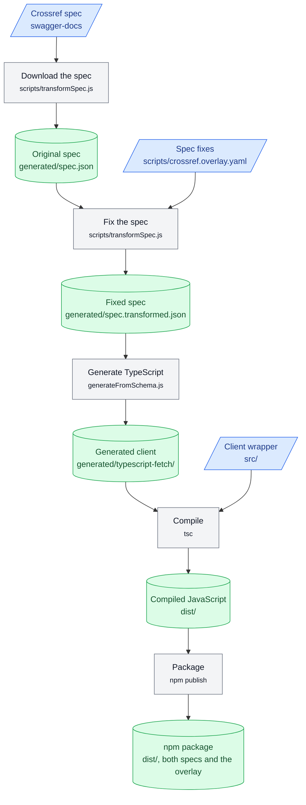

# crossref-api-client

OpenAPI client for the [Crossref REST API](https://api.crossref.org), generated from Crossref's published Swagger 2.0 spec.

## Installation

The package is published to GitHub Packages.

1. Create a GitHub personal access token (PAT) with the `read:packages` scope.
2. Add an `.npmrc` file to your project's root directory:
   ```
   @eresearchqut:registry=https://npm.pkg.github.com/
   ```
3. Log in to the registry, using your GitHub username and the PAT as the password:
   ```
   npm login --scope=@eresearchqut --registry=https://npm.pkg.github.com
   ```
4. Install the package:
   ```
   npm install @eresearchqut/crossref-api-client
   ```

## Usage

```ts
import { createCrossrefClient } from '@eresearchqut/crossref-api-client';

const { works, journals, funders } = createCrossrefClient({
  mailto: 'research.data@example.edu',
  headers: { 'User-Agent': 'my-app/1.0 (https://example.edu/my-app)' },
});

const { message } = await works.worksDoiGet({ doi: '10.1038/s41586-020-2649-2' });
const results = await works.worksGet({ queryAuthor: 'Josiah Carberry', rows: 20, select: 'DOI,title' });
```

`createCrossrefClient` returns one API object per resource (`works`, `funders`, `journals`, `licenses`, `members`, `prefixes` and `types`), the underlying `configuration`, and a `health()` function that calls `/heartbeat` and rejects unless Crossref reports `overall-status: ok`.

| Option | Description |
| --- | --- |
| `url` | Base URL. Defaults to `https://api.crossref.org`. |
| `mailto` | Contact email, added as the `mailto` query parameter of every request unless the operation sets its own. |
| `headers` | Extra request headers, such as a `User-Agent` that names your application. |
| `plusToken` | Metadata Plus key, sent in the `Crossref-Plus-API-Token` header. |
| `fetchApi` | Replacement for the global `fetch`. |

Crossref asks clients to identify themselves, and serves requests that do from the faster "polite" pool, so pass `mailto` and a descriptive `User-Agent`.

Every model is exported by its generated name (`Work`) and also under a `Crossref` namespace (`Crossref.Work`). The generated `Configuration` and API classes are exported too, if you want to build the client yourself.

### Field queries

The works routes (`worksGet`, `fundersIdWorksGet`, `journalsIssnWorksGet`, `membersIdWorksGet`, `prefixesPrefixWorksGet` and `typesIdWorksGet`) accept Crossref's field queries, such as `queryAuthor`, `queryBibliographic` and `queryContainerTitle`. They are sent as `query.author` and so on.

### Pagination

To read every result of a works or list route, pass a page function to `paginate`, which yields items lazily, or to `collect`, which returns them all. The page function receives a `cursor` and `rows` to put on the request:

```ts
import { collect, paginate } from '@eresearchqut/crossref-api-client';

const dois = await collect(
  paginate((cursor, rows) => works.worksGet({ cursor, rows, filter: 'from-pub-date:2024', select: 'DOI' })),
);

for await (const work of paginate((cursor, rows) => journals.journalsIssnWorksGet({ issn: '0028-0836', cursor, rows }), { rows: 500 })) {
  // break to stop requesting pages
}
```

The helper uses Crossref's deep paging cursor, starting at `*` and following `next-cursor`, because `offset` is limited to 10,000 results. It stops on a page shorter than `rows`, or once it has `total-results` items. `rows` defaults to 100, and Crossref allows at most 1,000.

### Errors

A request rejects with a `CrossrefApiError` when Crossref answers with a non-2xx status, when the request never reaches Crossref, or when `health()` cannot read the heartbeat body. The error has `method`, `url` and `message`, and then either:

- `status` and `body` for a response. The body is parsed JSON when Crossref sends JSON, such as the `validation-failure` message list on a 400, and text otherwise. A 404 body is `Resource not found.`.
- `code` for a network failure, such as `ECONNREFUSED`.

The generated `ResponseError` and `FetchError` are not thrown by this client. One gap remains: if a generated operation gets a successful response whose body is not valid JSON, or fails part way through, it rejects with the native `SyntaxError` or `TypeError`. This is because the generated runtime parses the body after the error middleware has run.

### Rate limits

Crossref answers `429` when a client exceeds its rate limit. The current limits are in the `x-rate-limit-limit` and `x-rate-limit-interval` response headers. At the time of writing, requests with `mailto` are allowed three per second and requests without it one per second. The client does not retry, so callers paging through large result sets should catch a `CrossrefApiError` with `status === 429` and back off.

## Development

```
npm run build
npm test
```

Generation needs Java 21 or later, because it runs the `@openapitools/openapi-generator-cli` npm package. The generator version is pinned in `openapitools.json`.

### How the client is built



Blue shapes are inputs, grey boxes are steps, with the script that runs them, and green cylinders are files the build writes.

The spec is not committed. Each build downloads it from `https://api.crossref.org/swagger-docs`, so building needs network access. Set `CROSSREF_SPEC_URL` to use another source. In GitHub Actions, the `build` workflow reads the `CROSSREF_SPEC_URL` repository variable and the manual `publish-prerelease` workflow takes a `spec_url` input. Both fall back to the default when blank.

The downloaded spec is saved as `generated/spec.json` and the fixed one as `generated/spec.transformed.json`. Both are git-ignored, but they are included in the published package with the overlay, so you can see exactly which spec a release was generated from.

### Spec fixes

The generated `FromJSON` functions silently drop any field the spec does not name, so every gap in the spec means lost data. `scripts/transformSpec.js` corrects the spec wherever it disagrees with what api.crossref.org returns.

Most fixes are [OpenAPI Overlay](https://spec.openapis.org/overlay/v1.0.0.html) actions in `scripts/crossref.overlay.yaml`, applied with `openapi-format`. The build fails if an action matches nothing in the downloaded spec, so a fix cannot silently stop applying after Crossref changes its spec. The overlay:

- Changes the `{issn}` path parameter from an array to a string.
- Adds the `query.<field>` parameters to every works route, using the field list from the API's own validation message.
- Adds missing properties: `date-time` and `timestamp` on `DateAndVersion`, `award-info` on `WorkFunder`, `acronym`, `number`, `sponsor` and `theme` on `WorkEvent`, and `award` and `award-start` (for grants) on `Work`.
- Makes `Journal.issn-type` an array, and keys `Journal.coverage-type` by `all`, `current` and `backfile`, rather than by content type as on members.
- Renames the misspelt `references-backfie` on `CoverageFull` to `references-backfile`.
- Adds `additionalProperties` to `Coverage`, `CoverageFull` and `Flags`, so keys Crossref adds later are kept.

One fix stays in code, because an overlay cannot express it. Nullable values use `x-oneOf`, which Swagger 2.0 does not support and the generator ignores, so each is replaced with its typed variant marked `x-nullable`.

### Quirks of the generated code

- The spec has no `operationId`s, so each operation is named from its path and method: `worksGet` for `GET /works`, `worksDoiGet` for `GET /works/{doi}` and `journalsIssnWorksGet` for `GET /journals/{issn}/works`. Renaming a path parameter upstream would rename the operation.
- Hyphenated JSON keys become underscores on the models (`message_type`, `total_results`, `next_cursor`, `date_time`, `date_parts`), while `DOI` and `ISSN` keep their case.
- The spec's `Date` definition is generated as `ModelDate`, to avoid shadowing the global `Date`.
- `/heartbeat` is not in the spec, so `health()` calls it directly.

### Tests

Tests run against a WireMock container started by `jest-testcontainers`. Each test registers its own stubs with [wiremock-captain](https://github.com/wbd-open-source/wiremock-captain), and `test/setup.ts` fails any test that sends a request no stub matched.

`test/Contract.test.ts` checks the spec against reality. It deserialises responses recorded from api.crossref.org (`test/fixtures`), including a sample of every work type, and asserts that every field survives a `FromJSON` and `ToJSON` round trip. It fails if the spec or the fixes stop matching the real JSON. Re-record the fixtures when Crossref changes its responses.
